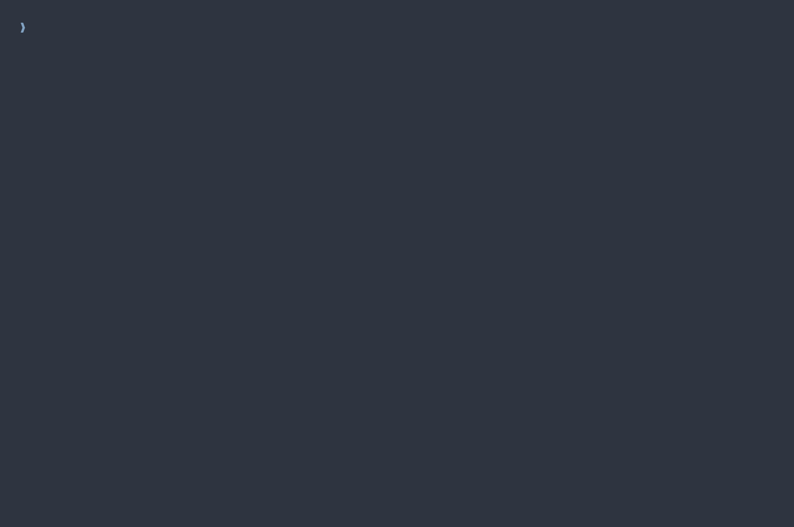
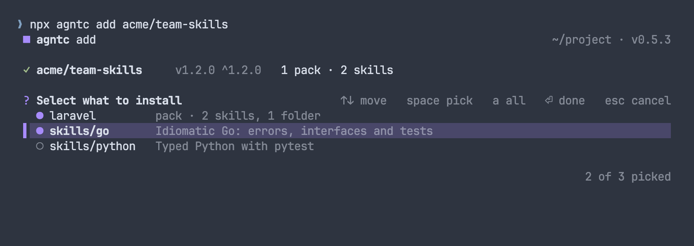
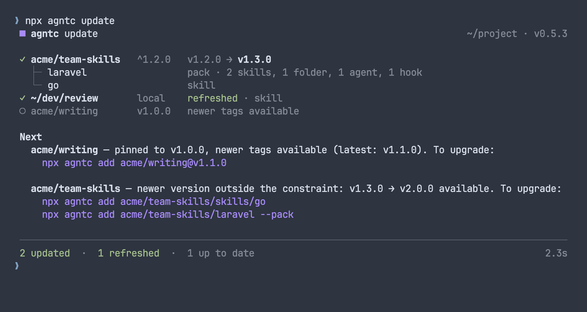
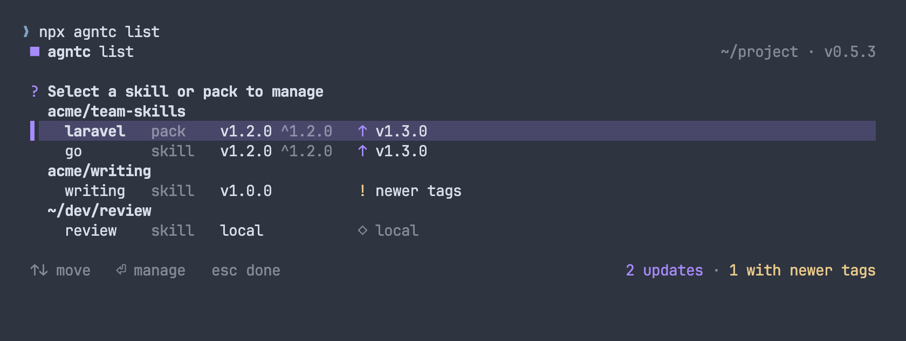
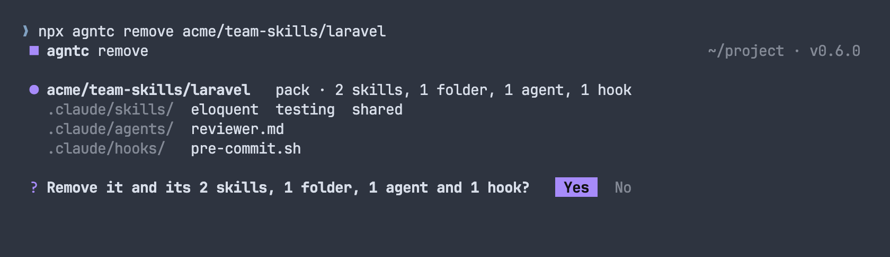
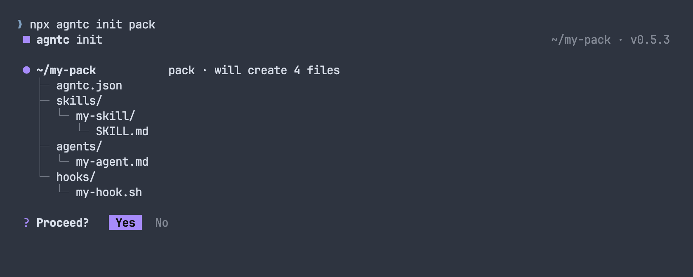

<div align="center">

# 📦 agntc

**Install Claude skills, agents and hooks from git repos, and keep them current**

agntc finds the skills in any repo, installs them into `.claude/`, and records what it installed,
<br>so `update`, `remove` and `list` work on whole installs, with packs that follow their repo as it changes.

[](https://www.npmjs.com/package/agntc)
[](LICENSE)
[](https://www.typescriptlang.org)

[Install](#install) · [Quick start](#quick-start) · [Packs](#skills-packs-and-support-folders) · [Commands](#commands) · [Scripts and agents](#scripts-and-agents) · [Authoring](#authoring)

<br>



</div>

---

## Why agntc?

A skill repo changes. Skills are added, renamed, moved and retired, and the agents and hooks that go with them change too. Copying folders by hand, or installing skill by skill, leaves your project holding a snapshot of the repo as it was the day you installed it.

agntc installs a **pack** as one thing. A pack is a folder its author declares with `{"type": "pack"}`, holding skills and, if it wants, agents, hooks and shared support folders. agntc records the pack, not a list of its skills, so every `update` reads the pack again: a skill added upstream arrives, a skill removed upstream goes, and its agents, hooks and support folders come along with it.

Vercel's [`skills`](https://github.com/vercel-labs/skills) CLI records each skill it installs as an entry of its own, `--all` included, and `skills update` updates those entries. A skill added to the repo after you installed stays uninstalled until you add it yourself. agntc's pack is the answer to that.

The rest of what agntc gives you:

- **One manifest.** Every install, its version and every file it wrote, in `.agntc/manifest.json`.
- **Semver constraints.** A bare `add owner/repo` installs the latest tag and records `^x.y.z`; `update` stays in that range and tells you what's newer outside it.
- **Updates that follow the repo.** A skill that moved is found again by its name, and a skill or pack gone upstream is asked about, never dropped silently.
- **Nothing overwritten without asking.** Files agntc didn't install, and files another install owns, are only replaced once you say so, or with `--overwrite`.
- **Checks before it deletes.** Every check an update makes runs before it removes a file, so an update that can't go ahead leaves the install as it was and prints the commands that mend it.
- **Project or global.** Install into the project's `.claude/`, or into `~/.claude/` with `-g`.
- **Scripts and agents.** Without a terminal, or with `--json`, each command prints one JSON document and never waits on a question.

agntc is for Claude only.

## Install

Run it with npx:

```bash
npx agntc@latest <command>
```

`npx` caches packages, so plain `npx agntc` can run an old version; `@latest` gets the newest.

Or install it globally:

```bash
npm install -g agntc
```

## Quick start

```bash
npx agntc@latest add owner/repo                    # what the repo holds; a menu when there's more than one thing
npx agntc@latest add owner/repo/laravel            # a pack, or a skill, by its path in the repo
npx agntc@latest add owner/repo --skill go python  # named skills
npx agntc@latest add 'owner/repo@^1.0'             # within a semver range
npx agntc@latest list                              # what's installed, and what has updates
npx agntc@latest update                            # update everything, within each constraint
npx agntc@latest remove owner/repo/laravel         # remove one install
npx agntc@latest init pack                         # scaffold a pack of your own
```

## What it looks like

Each command opens with a header and draws what it does as rows. A run with more than one outcome to count, or anything under Next, closes with a tally; a run with one outcome and nothing under Next ends on its row. A row's contents sit beneath it as a tree.

- **Work in progress spins on its row** (`cloning`, `updating to v1.3.0…`), then settles into the result.
- **A question is asked under the row it's about**, and is gone once answered.
- **Next** lists what you can do about the run: a newer version and the command to reach it, or the `remove` and `add` that mend an update that couldn't go ahead.
- **The tally** counts the run's outcomes, with the time it took.

Ctrl-C clears the spinner or the question, prints what the run had left to say, and exits. Colour follows `NO_COLOR` and `FORCE_COLOR`.

## Skills, packs and support folders

A **skill** is a folder with a `SKILL.md`. Everything in the folder belongs to it. It installs to `.claude/skills/<folder>/`, and its folder name is its name.

A **pack** is a set of skills, with agents and hooks if it has them, that installs, updates and removes as one entry. A pack is always declared, never guessed from the folder's shape:

- the author declares it with `{"type": "pack"}` in the folder's `agntc.json`, or
- you declare it with `--pack` when adding a folder.

A pack holds every skill inside it, plus the `.md` files in its own `agents/` and everything in its own `hooks/`. Packs don't nest.

A **support folder** is a folder in a pack's `skills/` that holds no skill, such as references the pack's skills share. It installs whole, beside the skills. A folder in `skills/` that holds skills deeper down is a category, and its folders are read the same way.

| What | Installs to |
|---|---|
| skills, and a pack's support folders | `.claude/skills/<folder>/` |
| a pack's agents (`.md` files) | `.claude/agents/` |
| a pack's hooks | `.claude/hooks/` |

Agents and hooks install only as part of a pack. A folder holding `agents/` or `hooks/` that isn't a pack gets a notice with the `--pack` line that would install them.

**Pack or skill?** Install a pack when you want what its author ships, as they change it. Install loose skills when you want those skills and nothing else: each is its own entry, `update` follows it if it moves, and nothing new is ever added to it.

## Commands

| Command | What it does |
|---|---|
| [`add <source>`](#add) | Installs skills and packs from a git repo or a local folder |
| [`update [key]`](#update) | Reinstalls what has changed upstream, within each constraint |
| [`list`](#list) | Shows what's installed and its update status, with actions |
| [`remove [key]`](#remove) | Removes installs and their files |
| [`init [skill\|pack]`](#init) | Scaffolds a skill or a pack |

`add`, `update`, `list` and `remove` take `-g` (`--global`): the install root is your home folder, with skills, agents and hooks under `~/.claude/` and the manifest at `~/.agntc/manifest.json`. Each command stays in one scope: `update` never touches global installs, and `update -g` never touches the project. Every command takes `--json`.

### `add`

```bash
npx agntc@latest add <source> [--skill <names...> | --pack | --all] [--list] [--overwrite] [-g] [--json]
```



| Source | Example |
|---|---|
| GitHub shorthand | `owner/repo` |
| A path in the repo | `owner/repo/skills/go` |
| A semver range | `owner/repo@^1.0`, `owner/repo@~2.1` |
| An exact tag | `owner/repo@v2.0.0` |
| HTTPS URL, any host | `https://gitlab.com/org/repo`, `https://gitlab.com/org/repo/skills/go` |
| SSH URL | `git@github.com:owner/repo.git`, `git@gitlab.com:org/repo/skills/go` |
| Tree URL | `https://github.com/owner/repo/tree/main/laravel` |
| Local folder | `./my-skills`, `~/dev/skills` |

**What it finds.** agntc walks down from the path you gave, the repo root by default. A folder with `SKILL.md` is a skill and a declared pack is a pack; neither is entered. Any other folder is searched, up to 5 levels down, so category folders such as `skills/frontend/` need nothing set up. Hidden folders, `node_modules`, `dist`, `build` and `vendor` are skipped.

**What it installs.**

- One thing found installs without a menu. Several give a menu: a line per pack, then loose skills by path. A pack is never split.
- `--skill <names...>` installs the skills named, by folder or frontmatter `name`, anywhere in the source, packs included. A skill taken from a pack installs on its own, without the pack's support folders, and a note says so. A name found twice is refused, with its paths.
- `--pack` installs the path you gave as one pack. It's refused on a single skill and on a path holding packs.
- `--all` installs everything the menu would list.
- `--list` shows what the source holds and installs nothing. It combines with `--pack` only.

`--skill`, `--pack` and `--all` don't combine. `--plugin` still works as `--pack`.

**Versions.**

- A bare `owner/repo` installs the latest semver tag and records `^major.minor.patch`. On 0.x the caret holds the minor.
- `@^1.0` or `@~2.1` installs the best tag in the range and records the range. Quote it in zsh: `'owner/repo@^1.0'`.
- `@v2.0.0` pins that tag, with no range.
- A repo without semver tags installs its default branch.

**Files in the way.** If an install would land on files another install owns, or on files agntc didn't install, agntc asks under that install's row before replacing them. `--overwrite` replaces them without asking. A skill already installed as part of a pack from the same repo isn't installed again on its own, and a pack takes over loose skills from its own repo.

### `update`

```bash
npx agntc@latest update [key] [-y] [-g] [--json]
```



With no key, every install updates; a key updates that install, or every install under it (`owner/repo`). Installs from one repo at one version intent are checked and cloned once, and update as one row.

An update deletes the install's files and installs it again at the new version. Everything that could stop it is checked first, so an update that can't go ahead leaves the install as it was and prints, under Next, the `remove` and `add` that would mend it.

- **Packs are read again.** Skills and support folders added upstream arrive; those removed go.
- **Moved skills are followed.** A loose skill whose folder moved is found again when exactly one skill in the repo has its name. When several do, the update stops and prints an `add` for each.
- **Nothing the repo still has is dropped.** An update that would remove a folder the repo still holds stops and names it.
- **Gone upstream is a question.** A skill or pack that's no longer in the repo is asked about under its row: yes removes it, no keeps it at its last version and asks again next time. `-y` removes without asking.
- **Constraints hold.** A ranged install updates within its range; a newer major prints the bare `add` that moves to it. A pinned tag shows newer tags and the `add` that reaches the newest.

An install that fails or can't go ahead doesn't stop the others; the command exits non-zero.

### `list`

```bash
npx agntc@latest list [-g] [--json]
```



Installs are grouped by repo, each with its kind, version, constraint and status: up to date, an update available, newer tags, local, check failed, or no matching version. Pick one for its details (what it installs, its constraint and any newer version outside it) and its actions: Update, Change version, Remove. Change version installs the tag you pick and drops the constraint.

### `remove`

```bash
npx agntc@latest remove [key] [-y] [-g] [--json]
```



A key removes that install, or every install under it (`owner/repo`). Without a key you pick from a list. agntc asks before deleting files; `-y` skips the question.

### `init`

```bash
npx agntc@latest init [skill|pack] [-y] [--json]
```



| Type | Creates |
|---|---|
| `skill` | `SKILL.md` with `name` and `description` frontmatter |
| `pack` | `agntc.json` (`{"type": "pack"}`), `skills/my-skill/SKILL.md`, `agents/my-agent.md`, `hooks/my-hook.sh` |

`init` asks for the type when you leave it out, shows the files it will create, and asks before writing; `-y` skips the question. Files already there are left alone.

## Scripts and agents

When stdin or stdout isn't a terminal, or with `--json`, agntc never draws and never waits:

- **One JSON document on stdout** per command, with `ok`, `command`, `scope` (on the commands that take `-g`), the command's result, `warnings` and `notes`. `ok` is true exactly when the exit code is 0. An error is a document too, with an `error`.
- **A question becomes a flag.** Where a terminal would ask, the command stops and its error names the flags that answer it:

| Question | Answer | Without it |
|---|---|---|
| What to install | `--skill`, `--pack`, `--all`, or the path to one skill or pack | `add` stops, its document listing what it found |
| Replace files in the way | `--overwrite` | That item stops, the rest install |
| Confirm a removal | `-y` | `remove` stops |
| What to remove | `remove <key>` | `remove` stops |
| Remove what's gone upstream | `update -y` | Kept and reported, exit 0 |
| What to scaffold | `init <type> -y` | `init` stops |

```json
{
  "ok": false,
  "command": "add",
  "scope": "project",
  "error": {
    "message": "acme/team-skills: found more than one thing to install — name what to install with --skill, --pack or --all, or add the path to one skill or pack: …",
    "flags": ["--skill", "--pack", "--all"]
  },
  "packs": [ … ],
  "skills": [ … ],
  …
}
```

## Authoring

`agntc.json` is optional. A repo of skill folders needs nothing else: `SKILL.md` makes a skill, and the folder name is its name. The frontmatter `description` shows in the menu and in `--list`.

Declare a pack when skills, agents and hooks belong together:

```
laravel/
  agntc.json          ← {"type": "pack"}
  skills/
    eloquent/SKILL.md
    testing/SKILL.md
    shared/           ← no SKILL.md: a support folder, installed to .claude/skills/shared/
  agents/
    reviewer.md       ← .claude/agents/reviewer.md
  hooks/
    pre-commit.sh     ← .claude/hooks/pre-commit.sh
```

- `agntc.json` holds only `type`. `"pack"` declares a pack, and the older `"plugin"` reads as `"pack"`. A malformed file is ignored. It's never copied into an install.
- A folder with both `SKILL.md` and a pack declaration is a skill, with a warning.
- Only `.md` files in `agents/` install as agents. Everything in `hooks/` installs.
- Users can take one skill out of your pack with `--skill`; it installs without the pack's support folders.
- `npx agntc init pack` scaffolds this layout.

## The manifest

`.agntc/manifest.json` (`~/.agntc/manifest.json` with `-g`) records each install:

```json
{
  "acme/team-skills": {
    "ref": "v1.3.0",
    "commit": "a8f749f55a7ea7cb15f5480c1b01df2a0db1f178",
    "files": [
      ".claude/skills/eloquent/",
      ".claude/skills/migrations/",
      ".claude/skills/shared/",
      ".claude/agents/reviewer.md",
      ".claude/hooks/pre-commit.sh"
    ],
    "type": "pack",
    "cloneUrl": "https://github.com/acme/team-skills.git",
    "installedAt": "2026-10-17T10:23:43.774Z",
    "constraint": "^1.2.0"
  }
}
```

A pack is keyed by its path in the repo, and a loose skill by its folder name, with `sourceSubpath` recording where it lives when the key doesn't say. `files` is what `remove` and `update` delete.

## Upgrading from 0.4 or earlier

0.5.0 was a breaking release.

- **Claude only.** Codex and Cursor support is gone, with the agent prompt and `agents` in `agntc.json`. Installs made for several agents move to `.claude/` on their next `update`.
- **Plugins are packs.** Manifest entries of type `plugin` read as packs, and `"type": "plugin"` still declares one. An entry keyed differently from how `add` keys it now moves to that key on its next update.
- **Packs are declared.** A folder with `agents/` or `hooks/` is no longer a pack by its shape. Use `--pack`, or ask the author to declare it.
- **Collections are gone.** A repo holding several things gives a menu.
- `--plugin` is now `--pack`; the old flag still works.

## Contributing

`CLAUDE.md` describes how agntc works, and [design/v2.md](design/v2.md) the design. Every change passes:

```bash
npm test
npm run build
```

`CHANGELOG.md` is written at release; don't edit it by hand.

## License

MIT
